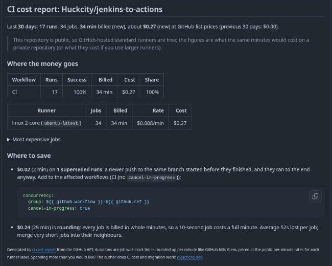

# CI Cost Report

A GitHub Action that prices every workflow run in your repository at GitHub's per-minute rates, shows where the money goes, and points at the waste you can remove this afternoon: runs a newer push superseded, failed runs, scheduled runs that rebuilt an unchanged commit, and the whole-minute rounding on tiny jobs.

No dashboard, no SaaS account, no dependencies. It reads the same Actions API your token already has, and writes Markdown to the job summary, a weekly issue, or a PR comment.



## Usage

Weekly report as a self-updating issue:

```yaml
name: CI cost
on:
  schedule:
    - cron: '17 6 * * 1'
  workflow_dispatch:
permissions:
  actions: read
  contents: read
  issues: write
jobs:
  cost:
    runs-on: ubuntu-latest
    steps:
      - uses: Huckcity/ci-cost-report@v1
        with:
          days: 30
          issue: true
```

Or add it as a job in an existing workflow: on pull requests it posts (and keeps updating) one comment; on every run it writes the job summary.

Several repositories at once, with a token that can read their Actions (a fine-grained PAT or a GitHub App token):

```yaml
      - uses: Huckcity/ci-cost-report@v1
        with:
          token: ${{ secrets.ORG_READ_TOKEN }}
          repos: acme/api, acme/web, acme/mobile
          self-hosted-rate: 0.004
          budget-usd: 2000
```

## What the report contains

- **Headline**: runs, billed minutes and estimated spend in the window, with the change against the previous window.
- **Where the money goes**: by workflow (with success rate), by runner type, and the ten most expensive jobs (matrix variants collapsed).
- **Where to save**, each with a number attached:
  - **Superseded runs**: a newer push to the same branch started before this run finished, and it ran to the end anyway. The fix is a four-line `concurrency` block, and the report says which workflows lack `cancel-in-progress`.
  - **Failed runs**: minutes spent on runs that did not succeed.
  - **Scheduled runs on an unchanged commit**: nightly builds that rebuilt the same SHA as the previous nightly.
  - **Rounding**: GitHub bills each job in whole minutes, so a 10-second job costs one minute. The report shows how much of your bill is rounding and the average seconds lost per job.
  - **Re-runs**: how many runs needed a second attempt.
- **Budget**: with `budget-usd` the report shows a budget line and the step fails when spend exceeds it, so the weekly run turns red when CI drifts.

Public repositories get a note that hosted standard runners are free for them; the figures are then what the same minutes would cost privately, which is still the right number for deciding what to optimise.

## Pricing

Rates are GitHub's public per-minute list prices by runner label, in USD:

| Runner | $/min | | Runner | $/min |
|---|---:|---|---|---:|
| Linux 2-core (`ubuntu-*`) | 0.008 | | Windows 2-core | 0.016 |
| Linux 4 / 8 / 16 / 32 / 64-core | 0.016 / 0.032 / 0.064 / 0.128 / 0.256 | | Windows 4 / 8 / 16 / 32 / 64-core | 0.032 / 0.064 / 0.128 / 0.256 / 0.512 |
| Linux Arm 2 / 4 / 8 / 16-core | 0.005 / 0.01 / 0.02 / 0.04 | | macOS 3/4-core (`macos-*`) | 0.08 |
| GPU Linux 4-core | 0.07 | | macOS large (12-core Intel) / xlarge (M-series) | 0.12 / 0.16 |

Override any of them with the `rates` input, for example `rates: '{"linux-2": 0.006}'` for negotiated pricing, and price self-hosted runners with `self-hosted-rate` (your amortised VM or node cost per minute; default 0). Core counts are read from labels such as `ubuntu-latest-8-cores` or `windows-latest-16core`; unknown counts round up to the next priced tier.

The report deliberately prices **list rates per job**, not your invoice: included free minutes, Enterprise discounts and the minute multipliers on included minutes are all left out so that the numbers stay comparable across repositories and months.

## Inputs

| Input | Default | Meaning |
|---|---|---|
| `token` | `github.token` | Needs `actions: read`. `contents: read` lets it check workflows for `cancel-in-progress`; `issues: write` / `pull-requests: write` to post. |
| `days` | `30` | Reporting window, 1–90 days. |
| `compare-previous` | `true` | Also analyse the previous window and show the change. Doubles the API calls. |
| `repos` | current repo | Comma-separated `owner/repo` list. |
| `max-runs` | `600` | Runs analysed per repository and window (one API call each). |
| `rates` | | JSON overriding rates by tier key. |
| `self-hosted-rate` | `0` | USD per minute for self-hosted jobs. |
| `budget-usd` | | Fail the step when spend exceeds this. |
| `fail-over-budget` | `true` | Set to `false` to only warn. |
| `issue` | `false` | Open or update one issue with the report. |
| `issue-title` | `CI cost report` | Title of that issue. |
| `comment-on-pr` | `true` | On pull requests, post or update one comment. |

## Outputs

`total-usd`, `total-minutes`, `previous-usd`, `superseded-usd`, `report-path`.

## How the numbers are made

For every completed run in the window the action lists its jobs (all attempts), takes each job's wall-clock time from `started_at` to `completed_at`, rounds it up to the next minute exactly as GitHub bills, and multiplies by the rate for the job's runner labels. API usage is one call per run plus one per 100 runs, so a repository with 500 runs a month costs about 500 calls per window, well inside the default token's hourly limit.

## Related

- [Skip Unchanged](https://github.com/marketplace/actions/skip-unchanged): the fix for "scheduled runs on unchanged commits"; skips the nightly when the commit already has a successful run.

[CI Step Timing Report](https://github.com/marketplace/actions/ci-step-timing-report) flags the jobs and steps that got slower on a pull request. [ci2actions.dev](https://ci2actions.dev) converts Jenkins, GitLab CI, Azure Pipelines, CircleCI, Bitbucket and Travis configs to GitHub Actions.

## Support

MIT. If this saved you money, [sponsoring](https://github.com/sponsors/Huckcity) keeps it maintained. For CI cost reduction or migration work done for you: [ci2actions.dev/migration](https://ci2actions.dev/migration/).
